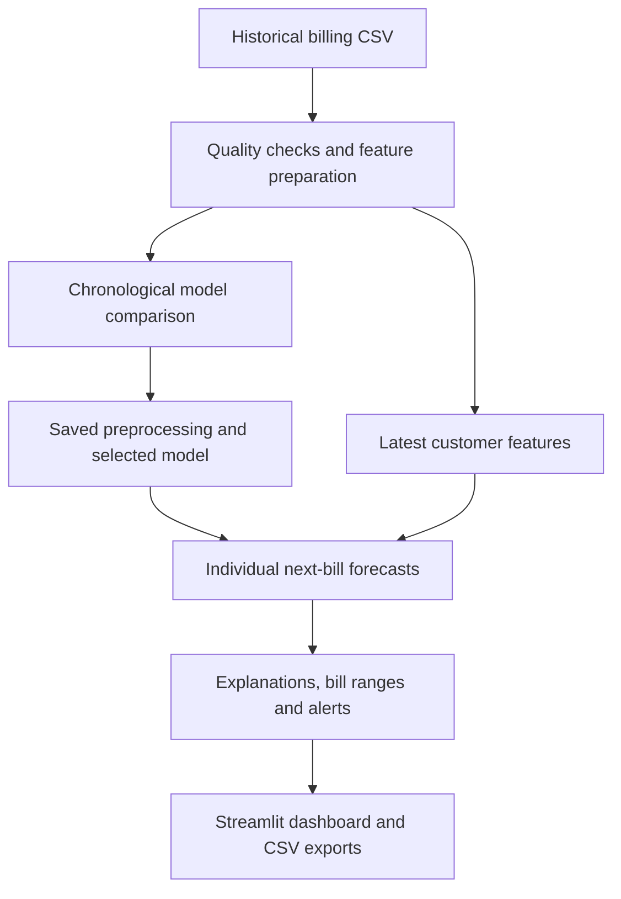

# NextBill: Individual Telecom Bill Prediction

A machine learning prototype that predicts each customer's next monthly telecom bill using their completed usage, plan, charges and billing history. It adds an estimated bill range, prediction explanations and a customer review queue.

**Forecast timing:** after May's bill is finalized, predict June's bill. One shared model produces a separate forecast for each customer.

## Project pipeline



## Files and responsibilities

Keep these files and generated folders in the same project directory.

| File or folder | Purpose |
|---|---|
| `01_eda_feature_engineering_preprocessing.ipynb` | Explore data, check quality, create features and prepare ML inputs |
| `02_model_training_evaluation.ipynb` | Compare models, evaluate later months and save the selected predictor |
| `03_explanations_uncertainty_high_bill_alerts.ipynb` | Create explanations, estimated ranges and customer priorities |
| `app.py` | Run the Streamlit dashboard |
| `sync_dashboard_inputs.py` | Export customer history and latest features for the dashboard |
| `requirements.txt` | Pinned dependencies for the supplied reference dashboard package |
| `prepared_data/` | Prepared inputs, metadata and preprocessing settings |
| `model_outputs/` | Saved model, forecasts and regression evaluation |
| `monitoring_outputs/` | Customer explanations, monitoring tables and evaluation |
| `dashboard_inputs/` | Dashboard history and latest customer features |

The CSV may be named `next_bill_amount_prediction_synthetic_dataset.csv` or end with ` (1).csv`. Step 1 supports both names. Update its `DATA_PATH` if needed.

## Setup and execution

### Use your working notebook environment

Use the **same Python environment** for all three notebooks, synchronization and Streamlit. In VS Code, check the notebook kernel at the top right.

If your notebooks already run correctly in Anaconda `base`, keep that environment and install Streamlit there:

```bash
python -m pip install streamlit
```

Run this command with the Python interpreter used by the notebooks. Do not reinstall pinned requirements into a working base environment, because changing pandas or scikit-learn versions can make existing saved files incompatible.

### Run in order

1. Open Step 1 and select **Run All**. It creates `prepared_data/`.
2. Run Step 2. It creates `model_outputs/`.
3. Run Step 3. It creates `monitoring_outputs/`.
4. In a terminal in the project folder, run:

```bash
python sync_dashboard_inputs.py
python -m streamlit run app.py
```

Leave the optional Streamlit email field blank and press Enter if prompted. Open the printed Local URL, usually `http://localhost:8501`. Keep the terminal running. Press Ctrl+C to stop the app.

On Windows, if the terminal uses `.venv` while the notebooks use Anaconda base, explicitly call base Python. Replace the path with the value of `sys.executable` from your notebook:

```powershell
& "C:\path\to\anaconda3\python.exe" -m pip install streamlit
& "C:\path\to\anaconda3\python.exe" sync_dashboard_inputs.py
& "C:\path\to\anaconda3\python.exe" -m streamlit run app.py
```

For a fresh installation of the packaged dashboard demo, install `requirements.txt` in a separate environment. The reference model uses pandas 2.2.3, NumPy 2.3.5 and scikit-learn 1.8.0. Keep saved models and their compatible environment together.

## Data preparation and reasoning

The supplied synthetic dataset contains **17,000 customer-month rows** for **1,000 customers**. Each row describes a completed month, and `next_bill_amount` is the target.

- Check missing values, duplicates, data types, customer-month uniqueness, monthly spacing and bill consistency.
- Sort records by customer and month before calculating history.
- Add previous two bills, a recent three-bill average and standard deviation, bill changes, average usage, usage changes and recorded history length.
- Add forecast-month cyclic features. The short dataset cannot establish annual seasonality.
- Encode plan names, impute missing input values and scale numeric features using training-fitted preprocessing.

There are **23 raw input features** and **25 numeric inputs** after encoding. History features help the model learn each customer's usual level and recent changes. Customer IDs and target labels are excluded from model inputs.

The following recorded bill verifies 16,000 targets. The final 1,000 targets cannot be independently cross-checked, so those rows support the prediction demo rather than scored evaluation. History calculations include the current completed month and earlier observations only.

## Model selection and evaluation

Splits follow the **forecast target month**, rather than random rows:

| Split | Target months | Rows |
|---|---|---:|
| Training | February–November 2024 | 10,000 |
| Validation | December 2024–February 2025 | 3,000 |
| Testing | March–May 2025 | 3,000 |

We compare Ridge regression, Random Forest and HistGradientBoosting with a training-median baseline, current-bill forecasts and recent-average forecasts. Settings are selected by validation MAE. HistGradientBoosting performs best among the candidates tested and is fast on this dataset.

Selected settings include 250 iterations, learning rate 0.05, 15 leaf nodes and L2 regularization of 1. Internal random early stopping is disabled so chronological validation determines the choice.

The selected regressor is refitted using 13,000 training and validation rows. The original training-fitted preprocessing stays fixed. Test labels do not select model settings. Earlier observed bills may update history for subsequent monthly forecasts, so this evaluates rolling forecasts for existing customers.

### Reference test results

| Forecast method | MAE | RMSE | WAPE |
|---|---:|---:|---:|
| HistGradientBoosting | 50.96 | 78.91 | 9.54% |
| Recent three-bill average | 58.80 | 89.01 | 11.01% |
| Current bill | 69.31 | 105.68 | 12.98% |

The model reduces MAE by **13.3%** compared with the recent-average baseline. MAE and RMSE use dataset bill units. WAPE measures error, not accuracy. Currency is unspecified.

These values come from the executed reference run on the supplied synthetic dataset. Check your local `model_outputs/model_summary.json` for your own run's results.

## Explanations, estimated ranges and high-bill alerts

**Customer explanations:** replace groups of features in a fixed order, starting with a typical pre-test record on the same plan. Prediction changes describe each group's influence along that comparison path. Contributions depend on the order and reference and do not establish billing causality.

**Estimated ranges:** use March forecast errors, normalized by recent average bill, to set a nominal 90% range. Evaluate coverage on April–May. Measured coverage is **88.35%** across 2,000 rows. These months already received point evaluation in Step 2, so this is an additional historical check rather than a new untouched dataset.

**High-bill threshold:**

```text
recent_three_bill_mean + max(
    20% of recent_three_bill_mean,
    50 bill units,
    2 × recent_three_bill_standard_deviation
)
```

- Point alert: predicted bill exceeds the threshold.
- Strong alert: the estimated lower bill bound exceeds it.
- Possible-risk watchlist: the estimated upper bill bound exceeds it, including point alerts.
- At least three recorded bills are required for automatic alerts.

The threshold values are illustrative prototype policy choices.

| Rule, April–May | High bills caught | Precision | Recall | Records flagged |
|---|---:|---:|---:|---:|
| Point-prediction alert | 5 of 174 | 55.56% | 2.87% | 0.45% |
| Upper-range watchlist | 157 of 174 | 10.51% | 90.23% | 74.70% |

Point predictions miss many sudden spikes. The broader watchlist catches more outcomes but creates substantial review workload. The dashboard shows both views separately.

## Dashboard demonstration

1. Search a customer ID, such as **C00626**.
2. Inspect the next-bill forecast, estimated range, recent average and threshold.
3. Review historical bills and feature-group explanations.
4. Click **Run saved model for this customer** to execute the saved predictor on their prepared inputs.
5. Filter the review queue and download customer results.
6. Open **Model performance** to review baselines, segmented errors and alert quality.

The Python app supports prepared existing customers in the latest available month. New invoice data must pass through the same feature-preparation workflow. The private browser demo displays exported saved results and does not execute the Python model.

## Refreshing results

After changing the dataset or pipeline, rerun notebooks 1–3 in order, run `python sync_dashboard_inputs.py`, and restart the dashboard. Synchronization alone does not train a model or create new forecasts. Preserve your locally generated output folders when connecting the dashboard to your own runs.

## Limitations and next steps

- Synthetic-data scores do not establish accuracy on real telecom records.
- The current evaluation covers existing customers and one-month forecasts.
- The model requires finalized monthly inputs, so it does not provide live mid-month predictions.
- Sudden-spike detection remains weak with point predictions.
- Repeated customers, short history and changing behaviour limit interval reliability.
- Latest demo outcomes are unverified, and there is no live telecom data connection.

Next steps are fresh real-data validation, additional usage signals available before billing closes, and business-approved alert thresholds.

## Troubleshooting

| Issue | Action |
|---|---|
| `StringDtype` or model-loading error | Use the same Python and library versions that created the saved files. Check notebook `sys.executable` against the terminal interpreter. |
| Missing output files | Run the notebooks in order and then synchronize dashboard inputs. |
| Missing module | Install it using the same Python interpreter used to run the app. |
| No customer matches | Clear the customer search, plan or priority filters. |
| Recomputed prediction differs from the displayed table | Rerun Step 3, synchronize inputs and restart the dashboard. |

## Technology

Python, pandas, NumPy, scikit-learn, Matplotlib, Seaborn, Joblib, Jupyter/VS Code and Streamlit.
